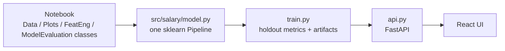

# From notebook to service

## What changed and why

1. **One pipeline instead of four stateful classes.** The notebook's classes changed global DataFrames in place, and fitted `LabelEncoder`s and group statistics that were never saved together with the model. So `legacy/model/Salary_Prediction_Best_Model.sav` can't be used on new postings by itself. The new `Pipeline` holds the encoder and the model together, so one `joblib` file covers everything needed for a prediction.
2. **No target leakage.** The notebook's `group_mean`, `group_median` and other group features were computed on all training rows before cross-validation, which made the reported MSE of 313 look better than it is. With about 6 rows per company × job × degree × major × industry group, each row's own salary dominates its group mean. The served model uses the raw categoricals with native categorical splits and reports a clean 10% holdout MSE of 359.5.
3. **Faster, current libraries.** `GradientBoostingRegressor(loss='ls')` and `Series.mad()` no longer exist in current scikit-learn and pandas. `HistGradientBoostingRegressor` trains on 900k rows in about 5 seconds, so training can run inside `docker build`.
4. **Data cleaning kept.** Zero salaries (found during EDA) are still dropped. `jobId` is excluded, as before.
5. **A serving contract.** The API validates numeric ranges and rejects category values the model never saw. It also exposes `/options` and `/insights`, so the UI never hard-codes categories.
6. **Reproducible environment.** `pyproject.toml` plus `uv.lock` are used for both CI and the image.

## Going further (not needed locally)
- If you want group statistics, use out-of-fold target encoding (for example scikit-learn's `TargetEncoder`, which cross-fits) inside the pipeline.
- Prediction intervals (quantile loss) so the UI can show a salary range.
- Keep the 1M-row CSVs in object storage or Git LFS rather than plain git.
- Model registry and versioned artifacts (MLflow), plus a scheduled retrain.
