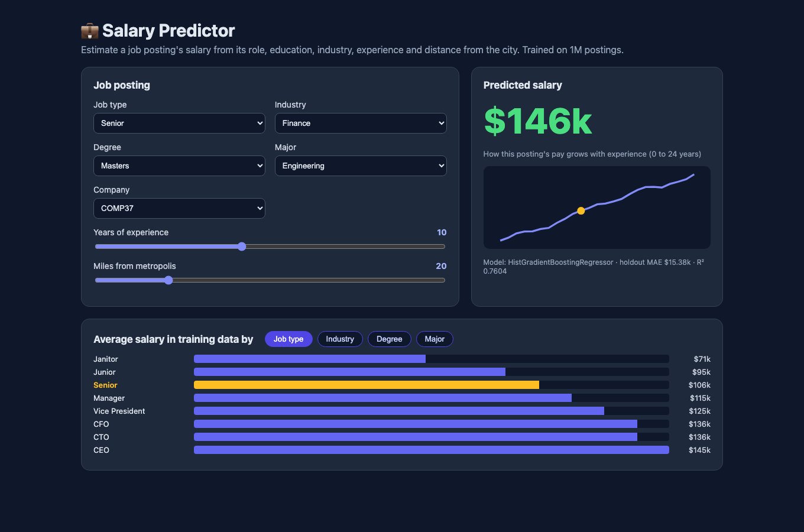
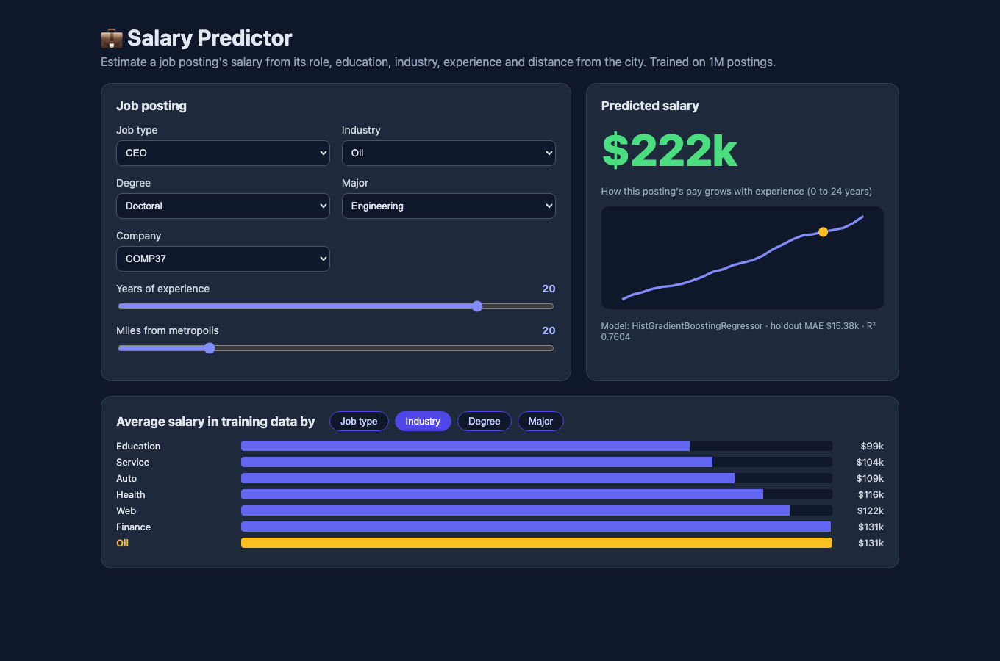
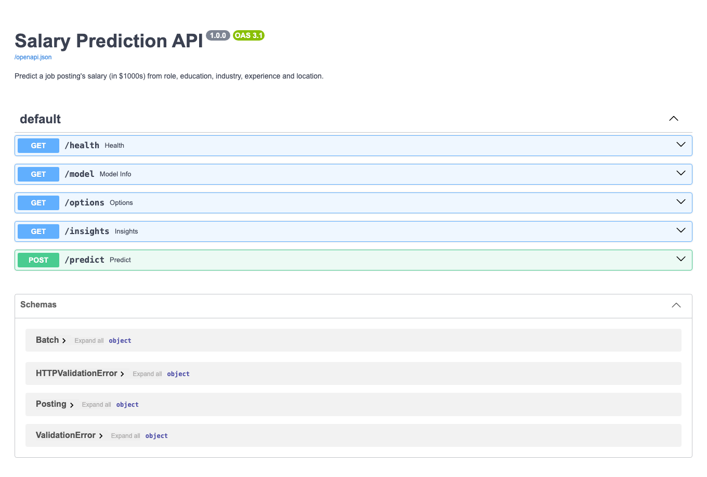
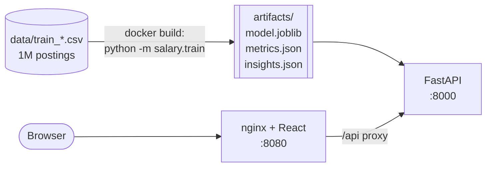
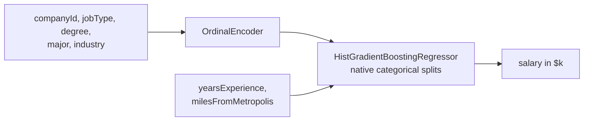

# 💼 Salary Predictor

<p align="center"></p>

**Estimate a job posting's salary from its role, education, major, industry, company, years of experience and distance from the city. The model is trained on 1 million postings and runs locally with one command.**

This started as a portfolio notebook (EDA, feature engineering and model comparison, found in `Salary Prediction Project.ipynb`; the original write-up is in [docs/ANALYSIS.md](docs/ANALYSIS.md)). It's now a small product: a **FastAPI** service with a gradient-boosting model, and a **React** app for exploring predictions.



---

## Quick start

```bash
cp .env.example .env
docker compose up --build
```

| Service | URL |
|---|---|
| React app (nginx) | http://localhost:8080 |
| FastAPI (Swagger docs) | http://localhost:8000/docs |

The model is **trained during `docker build`** from the committed CSVs in `data/` (1M rows, about 5 seconds). No model file is committed.

## The app

### 1. Describe a posting, get a salary
Pick the job type, industry, degree, major and company, then set experience and distance with the sliders. The prediction updates live, and the curve shows how this exact posting's pay changes from 0 to 24 years of experience.

### 2. Compare against the market
The bottom panel shows average salaries in the training data by job type, industry, degree or major, with the current selection highlighted.



### 3. Use the API directly

```bash
curl -X POST localhost:8000/predict -H 'content-type: application/json' -d '{"postings":[
  {"companyId":"COMP37","jobType":"CEO","degree":"DOCTORAL","major":"ENGINEERING","industry":"OIL","yearsExperience":20,"milesFromMetropolis":5},
  {"companyId":"COMP37","jobType":"JANITOR","degree":"NONE","major":"NONE","industry":"EDUCATION","yearsExperience":1,"milesFromMetropolis":90}]}'
# {"predictions":[{"salary_k":225.1},{"salary_k":26.3}]}
```

| Endpoint | Purpose |
|---|---|
| `POST /predict` | Up to 1,000 postings at a time. Returns salary in $1000s. Unknown category values get a 422. |
| `GET /model` | Model type and holdout metrics |
| `GET /options` | Valid values for each categorical field |
| `GET /insights` | Average salary by job type, industry, degree, major and years of experience |



## Architecture

<p align="center"></p>





## Model results

10% holdout (100,000 postings):

| Model | MSE | MAE | R² |
|---|---|---|---|
| Baseline: mean salary by job type | 962.7 | – | – |
| **HistGradientBoosting (served)** | **359.5** | **$15.4k** | **0.760** |

The notebook reported an MSE of 313 for its GradientBoostingRegressor. That number came from group statistics (mean, median, min and max salary per company × job × degree × major × industry) computed on the **full** training set before cross-validation, so the target leaked into the features. With a leak-free holdout, every model tried here plateaus around 359. See [PRODUCTIONIZING.md](PRODUCTIONIZING.md).

## Repo layout

| Path | What it is |
|---|---|
| `src/salary/` | Model definition, training script, FastAPI app |
| `web/` | React + Vite + TypeScript front end, built and served by nginx |
| `tests/` | Pipeline, data-loading and API tests (synthetic data) |
| `data/` | Training features and salaries, plus test features |
| `Salary Prediction Project.ipynb`, `images/`, `slides/` | The original analysis |
| `docs/ANALYSIS.md` | The original README and EDA write-up |
| `legacy/` | The original pickled model and submission CSV (moved, not deleted) |

## Development

```bash
uv sync && uv run pytest -q
uv run python -m salary.train            # writes artifacts/
uv run uvicorn salary.api:app --reload   # API on :8000
cd web && npm install && npm run dev     # React on :5173, proxies /api
```

CI (GitHub Actions) runs `uv sync --frozen` and `pytest`, then `docker compose build`, which also trains the model.
